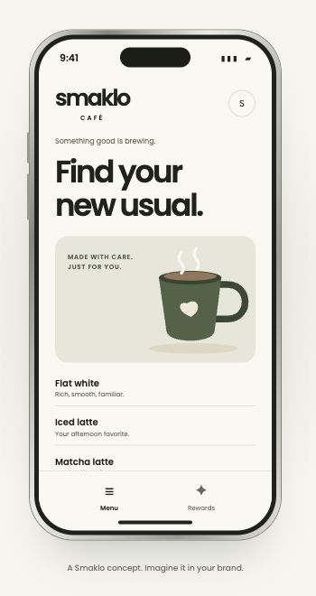
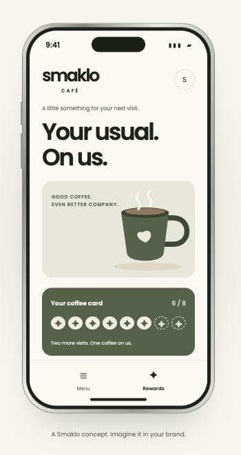
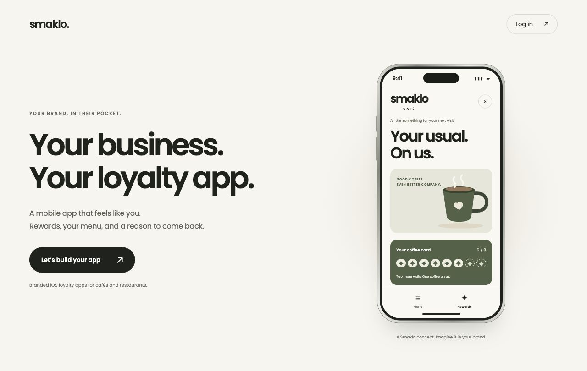

# Smaklo

Branded loyalty apps for independent cafés and restaurants, with a web dashboard for the people running them.

[smaklo.com](https://smaklo.com/)

<table>
  <tr>
    <td><a href="assets/menu.jpg"></a></td>
    <td><a href="assets/rewards.jpg"></a></td>
  </tr>
</table>

*The images above are the fictional café concept on the public website. They show the visual direction, rather than screenshots of the native app.*

## Why I built it

I wanted to make it practical for a small café to have an app that looked like its own business: its menu, its colors and a simple reason for customers to come back.

Building a completely separate app for every business would make updates and maintenance difficult. I started with an earlier restaurant app and developed it into a shared mobile codebase, a dashboard and a way to prepare branded demonstrations before a business commits to a launch.

Smaklo is still an early venture. I have built the product and demo workflow, but a repeatable sales process and paid pilots are still being validated.

## What I worked on

The project covers the customer app, the operator's dashboard and the work needed to show the product to a potential customer.

- A React Native app with menu browsing, loyalty cards, profiles and push-notification flows.
- A React dashboard for managing menu content, rewards and notifications.
- App Preview, a shared iOS demo app that loads different business configurations.
- A Python workflow for validating brand and menu inputs before they reach a preview.
- A recording and editing workflow for personalized product demonstrations.
- The public website and inquiry form.

The mobile app and dashboard are separate applications in one monorepo. They share product concepts and configuration, but keep their own builds and dependencies.

## How the previews work

App Preview lets me prepare a demonstration without building a new iOS binary for every business. A configuration supplies the business name, menu, reward settings, colors and a choice of layouts already included in the app.

```text
Validated business configuration
                 |
        App Preview database
          /              \
   iOS demo app      Web dashboard
```

The preview backend is separate from customer production data. The planned early customer deployment model also keeps each customer's backend, dashboard and native app identity separate.

There is an important limit to the configuration approach: a new menu or palette can load at runtime, but a new native capability, bundled font or layout implementation still needs a new app build. I keep that boundary explicit so a preview does not promise something the installed app cannot render.

## A few implementation decisions

**Branding belongs in configuration.** Business names and menus change frequently. Those inputs are validated separately from the shared screens, and visual differences use reusable presets rather than one-off branches for individual cafés.

**A demo environment needs its own boundaries.** Preview tables and functions live in a separate Supabase project. Dashboard actions are scoped to the selected preview business, so preparing a sales demo does not require editing a customer's live data.

**Making a useful demo is part of the product work.** I built scripts to combine an actual App Preview recording, a dashboard recording and a fixed voice-and-camera track. The compositor adds framing, a cursor and synchronized captions. Each export still gets visual and audio review.

Those sales recordings use a directed local demo: the phone's points change on a timeline and the notification is delivered through the iOS Simulator. They demonstrate the intended interaction; they are not evidence of a live purchase or an end-to-end backend transaction.

## The website

The public landing keeps the offer short: a branded app, rewards and a menu. The fictional café lets someone switch between a menu and a loyalty card before contacting me.

<table>
  <tr>
    <td><a href="assets/website.jpg"></a></td>
  </tr>
</table>

## Built with

- **React Native, Expo and TypeScript** for the shared iOS app and App Preview.
- **React, Vite and TypeScript** for the operator dashboard and public web experience.
- **Supabase** for authentication, Postgres data, row-level access rules and Edge Functions.
- **Python** for input validation and demo preparation.
- **Swift and FFmpeg** for parts of the recording and video-composition tooling.
- **GitHub Actions and Vercel** for checks and web releases.

## Status and source

The [website](https://smaklo.com/) is live. Smaklo is at the product demonstration and customer-discovery stage. Production customer provisioning, native ordering, POS integrations and delivery are not presented here as completed features.

This repository is a public project showcase. The platform source, customer configuration and internal operating tools remain private.
